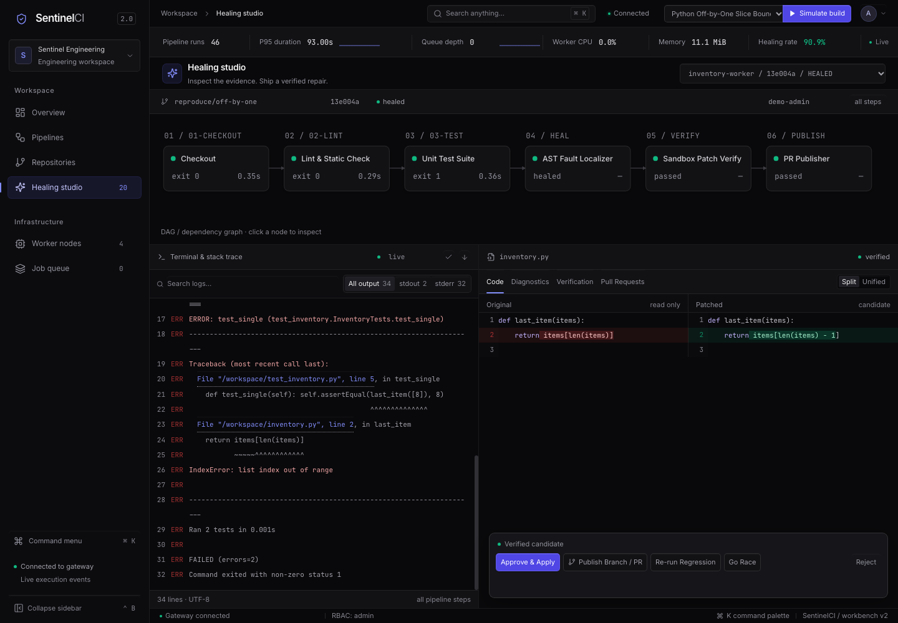
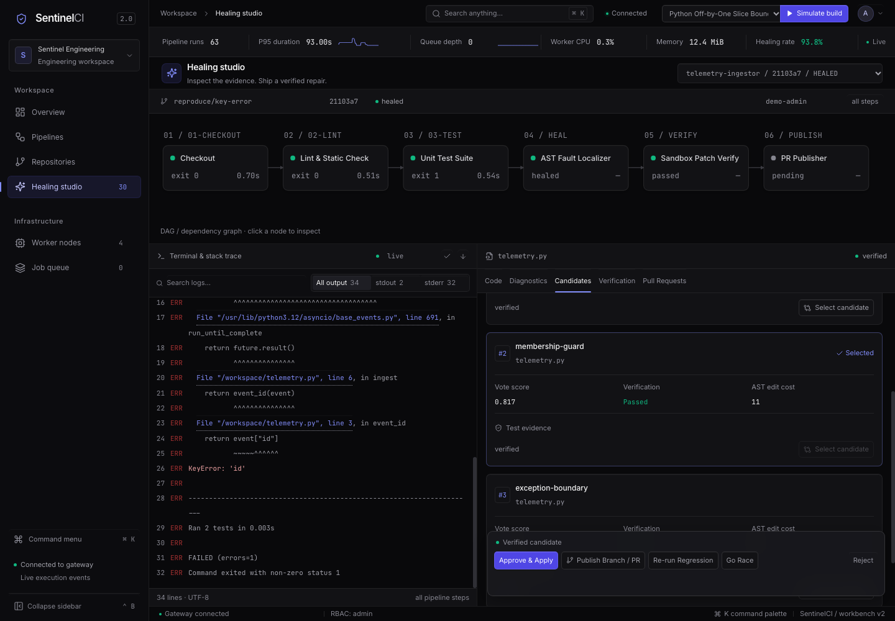
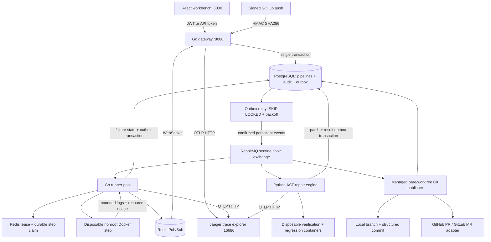
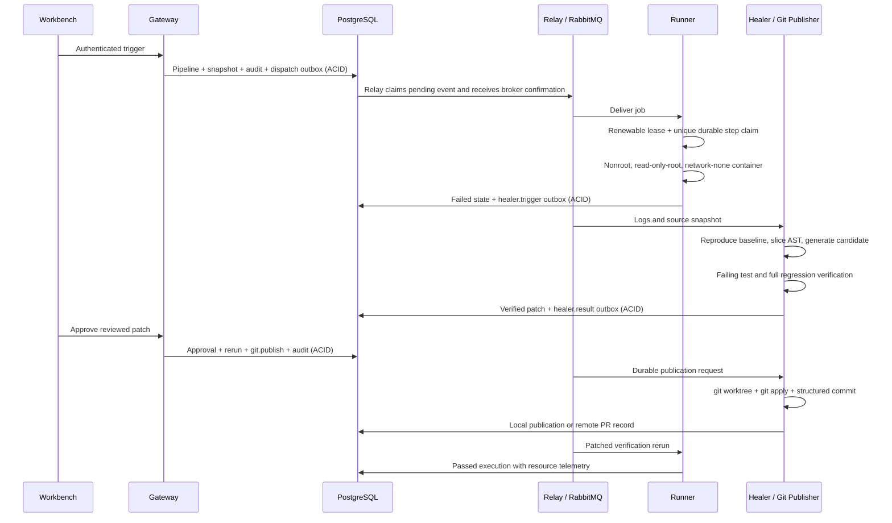

# SentinelCI

**A high-density delivery workbench with isolated build execution, verified repairs, and real Git publication.** Go services coordinate durable pipelines; a Python AST engine proposes and tests fixes; the React console exposes the same execution, review, and infrastructure state.



## Start

Requires Docker Engine and Compose v2:

```sh
docker compose -f deploy/docker-compose.yml up -d --build --wait
# http://localhost:3000/overview
python3 e2e/phase2.py
```

The local Compose configuration explicitly enables **Demo Admin Session**. The header switches Admin/Viewer roles; Session settings also accepts normal administrator credentials. Demo sessions are disabled unless the gateway's `SENTINEL_DEMO_MODE` is enabled. Before exposing a deployment, disable demo mode and supply your own JWT, administrator, internal-service and infrastructure secrets. The application rejects the bundled local authentication secrets when demo mode is disabled. Keep the Docker controller and its socket private.

Initialization includes five repositories, realistic hexadecimal revisions, commit messages and authors, twelve historical pipelines, forty-eight steps and six repair examples. Upgrade migrations apply to existing volumes through a versioned migration service. Historical examples are demonstration records, explicitly distinct from current execution. New simulations execute real tests and create real repair records.

## The workbench

| Route | Dedicated view |
| --- | --- |
| `/overview` | Filterable master/detail execution workbench, connected SVG DAG and live terminal |
| `/pipelines` | Branch/status/author execution matrix with step durations and log inspection |
| `/repositories` | Repository registration, default branches, webhook secrets and healing policies |
| `/healing-studio` | Three-pane DAG, ANSI trace inspector, split/unified diff and AST diagnostics |
| `/workers` | Individual runner routines, heartbeat freshness, controller CPU/RAM and sandbox policies |
| `/queue` | Broker queue depths, consumers, outbox retries, errors and dead events |

The obsidian workbench uses a 44px command bar and a 48px telemetry ribbon with observed SVG samples, p95 build duration, queue depth and resource counters. Missing measurements remain unreported; there are no decorative ascending charts. CPU/RAM counters are scoped to their controller host and deduplicated across routines; per-step workload CPU and peak RSS are stored separately. Self-hosted Inter and JetBrains Mono, an indigo accent system, a collapsible 240/64px sidebar, and frosted command/review surfaces form the visual system. `Cmd+K` / `Ctrl+K` opens grouped fuzzy navigation, pipeline switching and scenario commands. Clicking graph stages filters logs; source locations focus AST diagnostics. Patch actions approve/apply, publish a branch/PR, run Go race verification or reject review without destroying test evidence.

The five selectable scenarios are Go nil-pointer dereference (`payment-gateway`), Python off-by-one boundary (`inventory-worker`), Go concurrent map/data race (`order-matching-engine`), async Python KeyError (`telemetry-ingestor`) and ignored context cancellation (`auth-proxy`). Static previews use clearly labeled built-in data. A preview cannot approve a real change or claim backend execution.

## Tracing, candidate voting, and live analysis

OpenTelemetry spans connect the gateway request, transactional outbox relay, RabbitMQ producer/consumer, runner steps, healer candidates, sandbox verification, and result consumer. Only W3C `traceparent` and `tracestate` are forwarded in AMQP headers; the outbox stores them in the same transaction as the event. HTTP responses expose `X-Trace-ID`. Credentials, source code, command output and query strings are excluded from trace attributes. Compose exports OTLP HTTP to Jaeger at `http://jaeger:4318`; open **http://localhost:16686** to inspect traces. Outside Compose, set `OTEL_EXPORTER_OTLP_ENDPOINT` and a distinct `OTEL_SERVICE_NAME` per process. An absent exporter leaves context propagation enabled. The bundled Jaeger uses transient in-memory storage; configure persistent storage, access control and retention for a shared deployment. See [OpenTelemetry exporter configuration](https://opentelemetry.io/docs/languages/sdk-configuration/otlp-exporter/) and [Jaeger architecture APIs](https://www.jaegertracing.io/docs/2.20/architecture/apis/).

The deterministic repair engine generates **up to three distinct supported transformations**, rather than duplicating a proposal to fill a quota. Baseline failure is reproduced once; each candidate runs the failing test and full regression command in independent sandboxes. A process-wide semaphore bounds sandbox concurrency (`HEALER_CANDIDATE_CONCURRENCY=3`). Failed candidates score zero; verified candidates score `0.8 + 0.2 / (1 + AST cost)`. Stable ranking favors smaller AST edits and preserves rejected evidence. These scores express a deterministic ranking, not a calibrated probability of correctness. Approval and Git publication lock candidate selection; selecting another verified candidate before review atomically updates the diff and evidence and creates an audit record.

Runner output passes through a per-stream stateful secret masker before PostgreSQL inserts, Redis publication, RabbitMQ log events, or the healer failure-log buffer. It covers credential assignments, authorization headers, JWTs, known token prefixes, URL passwords, high-entropy tokens, configured secret values, PEM private keys, and multiline quoted/YAML block values. Redaction counts contain no original matches. Operational trace IDs, commit hashes and checksum manifests remain readable. Healer sandbox test output is redacted again before candidate evidence is saved. Executable source snapshots remain intact for repair; secret masking is a defense in depth for output, not a source-code secret scanner or a guarantee for arbitrary encodings.



Worker charts render observed CPU/RAM history on HiDPI Canvas, scoped to controller hosts, with bounded sample retention and gaps for missing data. Healing Studio renders parser-derived same-module call dependencies and candidate evidence; it does not invent dependencies for historical records that lack AST metadata.

```sh
python3 e2e/phase3.py          # exported distributed trace + candidate voting/selection
python3 e2e/phase3_masking.py  # generated secret probes: PostgreSQL and live WebSocket
# Run this alongside phase3.py to observe parallel verification under bounded load:
python3 e2e/phase3_load.py --seconds 90 --require-parallel
```

## Architecture





## The four hardening gaps

**Authentication and authorization.** HMAC-signed HS256 JWTs have issuer, expiry and role validation. Opaque API tokens use `X-Sentinel-Token`; only SHA-256 token hashes are persisted and revocation takes effect on the next request. Admin can manage tokens and audit history; Maintainer can execute and review pipelines; Viewer can read. WebSockets authenticate as well. Public health/login and GitHub webhook routes have explicit handling; GitHub pushes require the repository's HMAC-SHA256 secret and validated revision. Pipeline actions, review, token management and configuration changes have transactional audit records. WebSocket query tokens are omitted from nginx access logs.

**Transactional dispatch and deduplication.** Pipeline/snapshot/audit/outbox creation commits atomically. The relay locks pending rows with `FOR UPDATE SKIP LOCKED`, waits for RabbitMQ publisher confirmation, retries with bounded exponential delay, and marks exhausted events `DEAD`. Failure-to-healer and healer-result transitions use the same pattern. The outbox intentionally permits redelivery after an ambiguous broker acknowledgement; Redis owner-token leases and a unique PostgreSQL `step_executions` claim prevent duplicate command execution. Completed claims are skipped. A crash with ambiguous in-flight execution fails closed as `INTERRUPTED`; a new pipeline is required to retry. This favors at-most-once effects over blindly reexecuting arbitrary commands after a crash.

**Per-step isolation and quotas.** The runner requires the Docker backend in production and fails closed if the daemon is unavailable. Job containers receive source through tar input into a job-specific named volume. They receive no controller socket, host bind mount, service credentials or inherited environment. Containers run UID 65532 with a read-only root, all capabilities dropped, no-new-privileges, network disabled by default, bounded memory/swap/CPU/PIDs, file/core/open-file/CPU limits and writable constrained temporary storage. Go/Python verification uses the same disposable-container boundary. Deadlines kill the process group and remove the container; controller restart reaps its interrupted step containers. Workload resource measurements are observational and never replace cgroup-enforced quotas. Docker controllers themselves are trusted infrastructure with daemon access, not workload containers.

**Git branches and PR publication.** Approval atomically queues `git.publish` and the reviewed rerun. The publisher uses a locked managed bare/worktree store, verifies captured original source, applies the actual unified diff with `git apply`, verifies resulting source, and creates `sentinel/fix-<category>-<short-sha>` (with deterministic owner/content suffixes on conflict) with a structured root-cause/test-evidence commit and signoff. `GIT_SIGNING_KEY` enables cryptographic signing when the deployment supplies GPG tooling/key material. Without remote credentials the result is an actual local Git branch and commit, reported as `LOCAL`, rather than a fabricated hosted PR. With `GITHUB_TOKEN` or `GITLAB_TOKEN`, adapters push the branch and create/recover the provider PR/MR. Per-patch advisory locks, deterministic Git references and remote head/base lookup support safe retries. `GET /api/v1/pulls` and `/pulls/{id}` expose publication records.

## Repair algorithm

Python traceback/pytest frames and Go panic, race and timeout traces identify source candidates. Python `ast` and Go Tree-sitter locate enclosing functions, same-module helpers and cyclomatic complexity. Ochiai and Tarantula helpers implement spectrum formulas; trace-only scores are explicitly assumptions, not measured coverage probabilities. The workbench shows mutations and diagnostics alongside verification output.

Offline deterministic rules cover supported boundary errors, optional-value guards, missing imports, conversions, omitted mutex protection, discarded errors, missing mapping keys, ignored context cancellation, and parameterization of supported SQLite SELECT concatenations. An optional `LLM_API_KEY` enables an OpenAI-compatible candidate adapter; candidates still must satisfy the same checks. The baseline must fail, the candidate must pass its failing-test command, and an explicit or derived regression suite must pass. Attempts, output size, source size and overall verification time are bounded. Passing tests establish tested behavior, not a proof of arbitrary semantic equivalence.

## Configuration and development

Go 1.23+, Python 3.12+ and Node 22+ support local development. See `.env.example` for deployment variables. Broker routing keys are `jobs.dispatch`, `logs.stream`, `healer.trigger`, `healer.result` and `git.publish`; poisoned/exhausted healing deliveries route to `healer.dead`. PostgreSQL stores durable history and Redis Pub/Sub provides live delivery; reconnects reload persisted logs.

```sh
make setup
make build
make test
make test-race
make lint
make integration
python3 e2e/phase2.py
python3 e2e/load.py --requests 100 --concurrency 8
make clean # stops containers, preserves data volumes
```

Gateway routes and payloads are documented in `contracts/openapi.yaml`; event payloads in `contracts/events.schema.json`. `deploy/migrate.sh` tracks applied migration filenames, and migration files are immutable after deployment. The initial schema/seed runs on a fresh PostgreSQL volume; subsequent migrations also run against existing volumes. Configure `SANDBOX_NETWORK=bridge` only when a workload explicitly needs network access. Offline jobs requiring additional packages must use a prepared sandbox image.

## Observed verification telemetry

The Phase 3 local run exported 60 linked spans across all three services, verified three distinct repair candidates, and completed all five scenario repairs with green approved reruns and real local Git commits. A 90-second health probe served 6,410 requests with zero errors (p95 26.30 ms); a separate probe inspected seven isolated verification containers and observed a maximum of three concurrent candidates. These are measured local results, not a capacity guarantee. The complete browser audit covered twelve desktop/mobile route loads, actual AST edges, candidate selection and two live Canvas heartbeat samples. Reproduce and inspect the conditions in [VERIFICATION.md](VERIFICATION.md).

## Verification and operations

[VERIFICATION.md](VERIFICATION.md) records the actual final test counts, coverage, browser-route checks, isolation checks, five-scenario end-to-end results and observed measurements. No remote provider credential is needed for local Git verification. Hosted PR integration is tested with controlled adapter responses unless deployment credentials are supplied.

The four Phase 1 feature gaps now have implemented controls. Deployment still requires normal operational choices: TLS at an ingress, rotated secrets, protected Docker control sockets, backups and an operator policy for dead events/interrupted jobs. Inspect outbox status/errors in Job Queue and review `healer.dead` before replaying only authorized work. Containers share the host kernel; stronger hostile-tenant boundaries can use dedicated Docker hosts or microVMs without changing the dispatch contracts.
